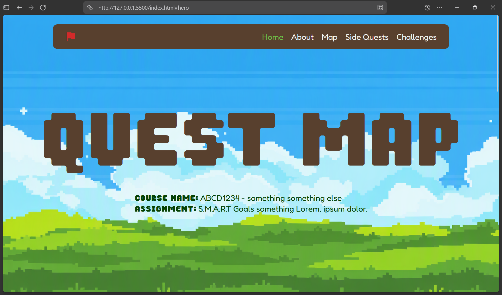
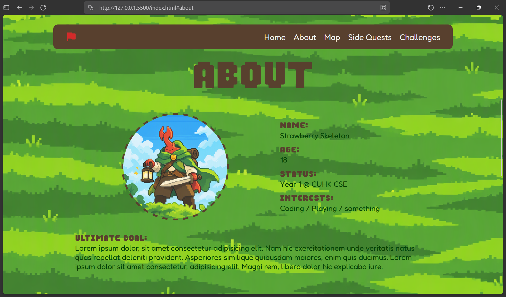
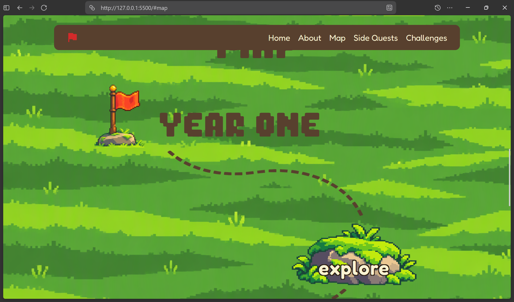
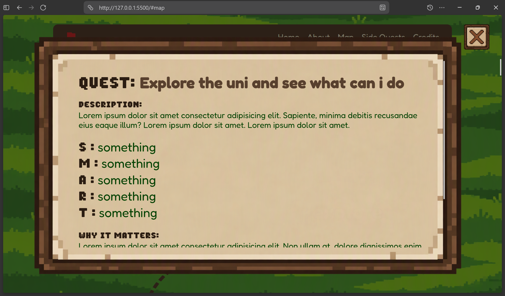
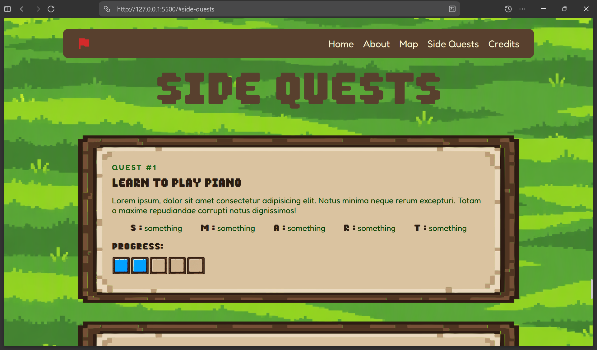
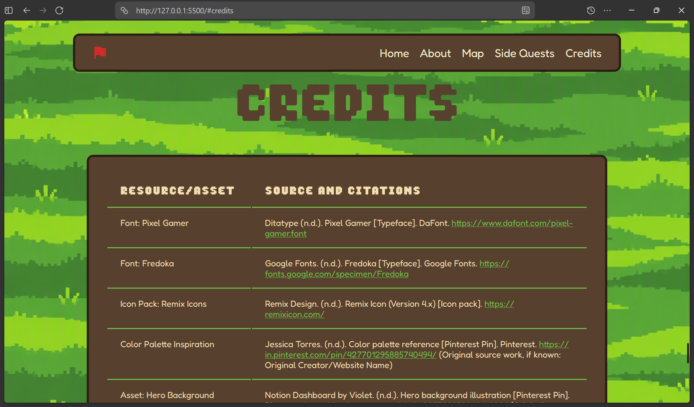

# Quest Map
Roadmap for univeristy life plans and goals [template edition]

> (made to prove a point to my sister)

This is a website where I have made a roadmap to map the goals someone might have in university. It starts from description and about of the person and states the main goal. Then we break the main goal into S.M.A.R.T style goals for each year with atleast 4 checkpoints. And since some fun is also important, there is a side-quest section to put any non-main-goal-related goals with a progress bar. This layout can help you see your goals in one (nice-looking) place without having to open random diaries etc. It is very easy to update the goals as well (just change the list in JS file) so if there's any change of plans or re-adjustment needed it can be done.

> NOTE: this is a template with a lot of Lorem text.
> if you wish to use this for yourself, you can change roadmap section text in js file, and other section's from html file.

## Features
- custom ui design
- pixel art theme
- Sections:
    - hero
    - about
    - map (with year 1-4 roadmaps maps)
    - side quests
    - credits (university style citation)
    - navbar/footer
- data picked from js for the checkpoint quest overlay
- open/close checkpoint quest overlay using js
- small design features like custom selection color, custom scrollbar colors, hover effects, etc. 
- Vanilla HTML/CSS/JS for making this

## Project Screenshots

hero section

about section

map section

side quests section

credits section

## Why I Made This
Basically my older sister is in unversity and she got an assignment to make a S.M.A.R.T goals type plan for the entire 4 years of university. She got an option to make a website or write an essay for this. She chose the essay but I think website would be wayyy cooler. Therefore, to prove my point on how cool and taking almost the same amount of time would the website assignment be, I made this project.
(unfortunately for me, she didn't care that this looks soo much cooler.....)

I designed the entire layout by myself and coded (almost all of it) myself.
This was a web dev practice project.

## Run Locally
1. clone this repo
2. open `index.html` in the browser

## Credits
- made by me
- main credits: [please refer to the credits section]

> ## AI USAGE
> - generate certain assets (refer to the credits section on the website)
> - code for making this responsive (for the main code, made minor adjustments myself)
> - minor debugging for random small issues (like a horizontal scrollbar appearing out of nowhere, making the background fit properly)

## MIT License

Copyright 2026 Strawberry Skeleton

Permission is hereby granted, free of charge, to any person obtaining a copy of this software and associated documentation files (the “Software”), to deal in the Software without restriction, including without limitation the rights to use, copy, modify, merge, publish, distribute, sublicense, and/or sell copies of the Software, and to permit persons to whom the Software is furnished to do so, subject to the following conditions:

The above copyright notice and this permission notice shall be included in all copies or substantial portions of the Software.

THE SOFTWARE IS PROVIDED “AS IS”, WITHOUT WARRANTY OF ANY KIND, EXPRESS OR IMPLIED, INCLUDING BUT NOT LIMITED TO THE WARRANTIES OF MERCHANTABILITY, FITNESS FOR A PARTICULAR PURPOSE AND NONINFRINGEMENT. IN NO EVENT SHALL THE AUTHORS OR COPYRIGHT HOLDERS BE LIABLE FOR ANY CLAIM, DAMAGES OR OTHER LIABILITY, WHETHER IN AN ACTION OF CONTRACT, TORT OR OTHERWISE, ARISING FROM, OUT OF OR IN CONNECTION WITH THE SOFTWARE OR THE USE OR OTHER DEALINGS IN THE SOFTWARE.
