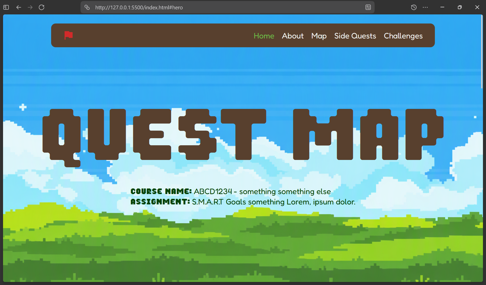
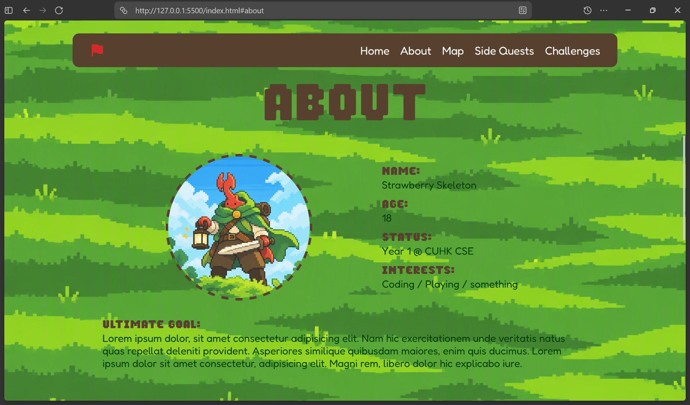
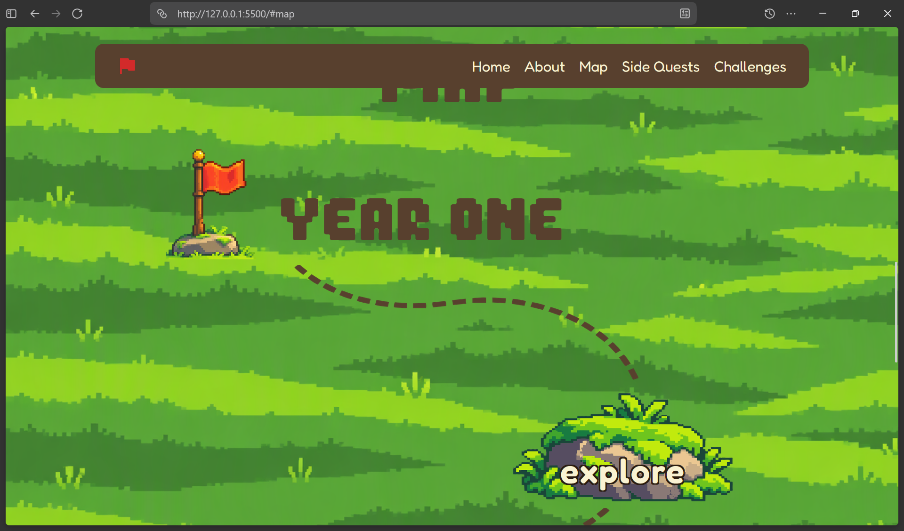
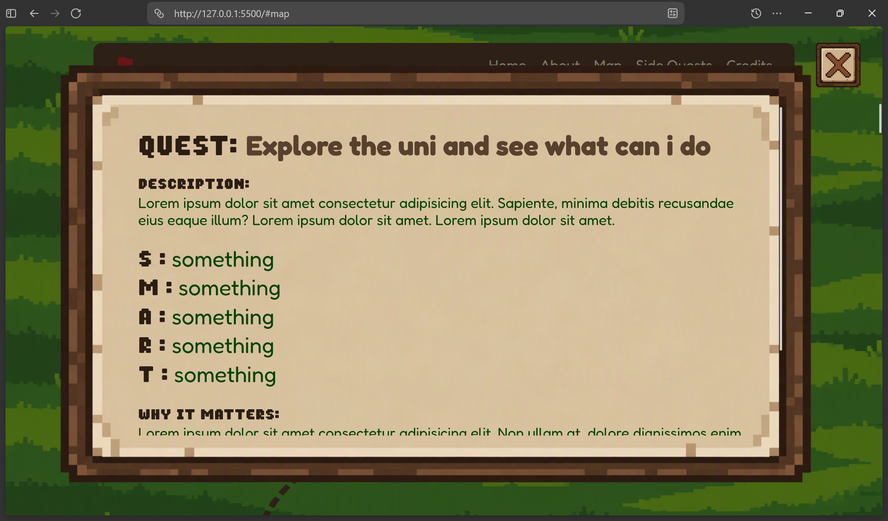
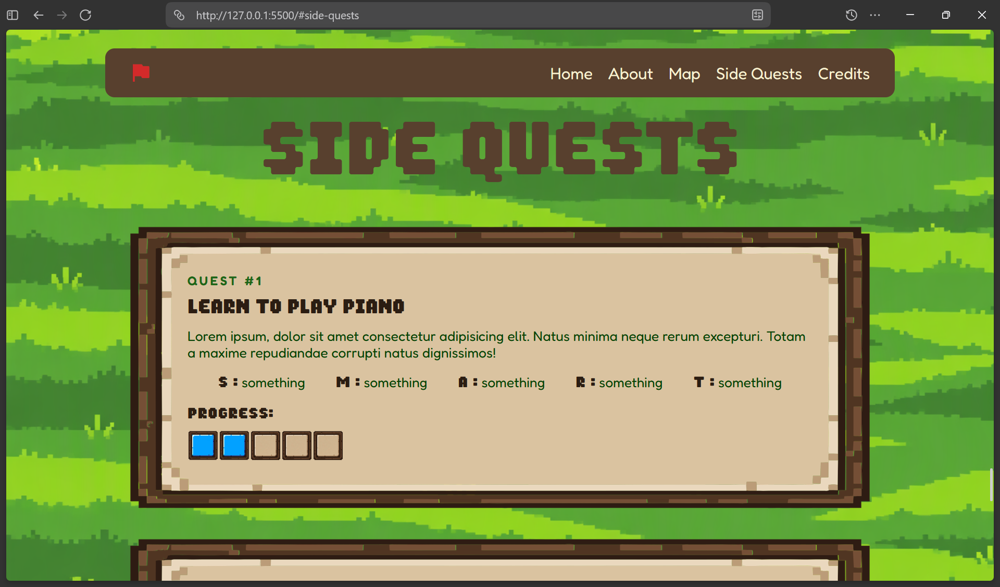
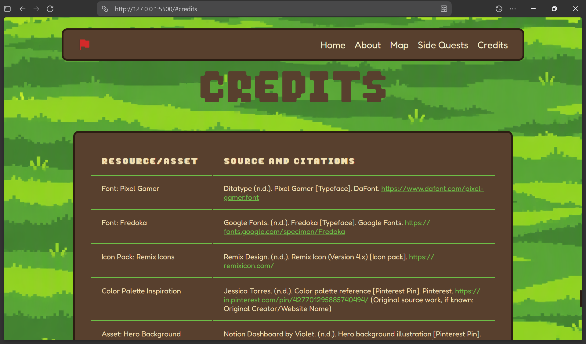

# Quest Map
Roadmap for univeristy life plans and goals

> (made to prove a point to my sister)

## Features
- custom ui design
- pixel art theme
- Sections:
    - hero
    - about
    - map (with year 1-4 roadmaps maps)
    - side quests
    - credits (university style citation)
    - navbar/footer
- data picked from js for the checkpoint quest overlay
- open/close checkpoint quest overlay using js
- small design features like custom selection color, custom scrollbar colors, hover effects, etc. 
- Vanilla HTML/CSS/JS for making this

## Project Screenshots

hero section

about section

map section

side quests section

credits section

## Why I Made This
Basically my older sister is in unversity and she got an assignment to make a S.M.A.R.T goals type plan for the entire 4 years of university. She got an option to make a website or write an essay for this. She chose the essay but I think website would be wayyy cooler. Therefore, to prove my point on how cool and taking almost the same amount of time would the website assignment be, I made this project.
(unfortunately for me, she didn't care that this looks soo much cooler.....)

I designed the entire layout by myself and coded (almost all of it) myself.
This was a web dev practice project.

## Credits
- made by me
- main credits: [please refer to the credits section]

> ## AI USAGE
> - generate certain assets (refer to the credits section on the website)
> - code for making this responsive (for the main code, made minor adjustments myself)
> - minor debugging for random small issues (like a horizontal scrollbar appearing out of nowhere, making the background fit properly)